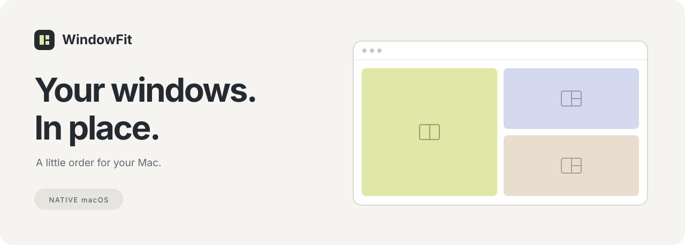

<div align="center">



# 창맞춤 · WindowFit

**창 정리는 가볍게. 작업 공간은 내 방식대로.**

단축키를 누르거나 화면 가장자리로 끌어 놓으세요.<br>
메뉴 막대에 머무는 작은 앱이 창의 위치와 크기를 맞춰 줍니다.

`macOS` · `Swift` · `외부 패키지 없음` · `네트워크 연결 없음`

[빠른 시작](#빠른-시작) · [단축키](#단축키) · [드래그 배치](#드래그-배치) · [사용 가이드](사용방법.md)

</div>

---

## 필요한 자리에, 필요한 크기로

| 나란히 비교하기 | 공간 나누기 | 다시 돌아가기 |
| :--- | :--- | :--- |
| 좌우·상하 **절반 배치** | 네 모서리 **4분할 배치** | **원래 위치와 크기 복원** |
| 문서와 브라우저를 함께 | 여러 창을 한 화면에 | 정리 전 작업 공간으로 |

- **화면에 맞추기** — 메뉴 막대와 Dock을 남기고 작업 공간을 채웁니다.
- **가운데로 모으기** — 현재 크기를 유지하며 창을 중앙에 놓습니다. 화면보다 큰 창은 축소합니다.
- **다중 모니터** — 창이 가장 많이 걸쳐 있는 화면을 기준으로 배치합니다.
- **드래그 미리보기** — 놓기 전에 배치될 영역을 확인합니다.

<sub>상단 이미지는 창 배치를 설명하는 일러스트입니다.</sub>

## 빠른 시작

### 1. 빌드하고 실행하기

Xcode 개발 도구가 설치된 맥에서 실행합니다. 비공개 저장소이므로 저장소 접근 권한이 있는 GitHub 계정이 필요합니다.

```sh
git clone https://github.com/Harry1757/windowfit.git
cd windowfit
./build.command
open 창맞춤.app
```

### 2. 창 제어 허용하기

**시스템 설정 → 개인정보 보호 및 보안 → 손쉬운 사용**에서 **창맞춤**을 켭니다.

### 3. 첫 번째 창 정리하기

정리할 창을 선택하고 <kbd>Control</kbd> + <kbd>Option</kbd> + <kbd>←</kbd>를 누르세요.<br>
창이 왼쪽 절반에 배치됩니다. 메뉴 막대의 **네 칸 아이콘**에서도 같은 기능을 사용할 수 있습니다.

> **검증 환경** · Apple Silicon / macOS 26.6.2 / Swift 6.3.3<br>
> 다른 운영체제 버전과 하드웨어에서의 호환성은 별도 확인이 필요합니다.

## 단축키

모든 단축키는 <kbd>Control</kbd> + <kbd>Option</kbd>과 함께 누릅니다.

| 배치 | 추가 키 | 배치 | 추가 키 |
| :--- | :---: | :--- | :---: |
| 왼쪽 절반 | <kbd>←</kbd> | 오른쪽 절반 | <kbd>→</kbd> |
| 위쪽 절반 | <kbd>↑</kbd> | 아래쪽 절반 | <kbd>↓</kbd> |
| 왼쪽 위 | <kbd>U</kbd> | 오른쪽 위 | <kbd>I</kbd> |
| 왼쪽 아래 | <kbd>J</kbd> | 오른쪽 아래 | <kbd>K</kbd> |
| 화면에 맞추기 | <kbd>Return</kbd> | 가운데로 | <kbd>C</kbd> |
| 원래 위치·크기 | <kbd>Delete ⌫</kbd> | | |

## 드래그 배치

창의 **제목 막대**를 잡고 가장자리로 끌어 보세요. 미리보기 영역이 나타나면 놓습니다.

| 놓는 위치 | 배치 결과 |
| :--- | :--- |
| 왼쪽 / 오른쪽 가장자리 | 해당 방향 절반 |
| 네 모서리 | 해당 방향 4분의 1 |
| 위쪽 가장자리 | 화면에 맞추기 |
| 아래쪽 가장자리 | 아래 절반 |

**잠깐 취소하려면** <kbd>Option</kbd>을 누른 채 놓으세요.<br>
**단축키만 쓰려면** 앱 메뉴에서 ‘가장자리로 끌어 놓기’를 끄세요.

## 알아두면 편해요

<details>
<summary><strong>권한은 켜져 있는데 작동하지 않아요</strong></summary>

이 앱은 개인용 임시 코드 서명을 사용합니다. 재빌드하면 macOS가 이전 실행 파일에 허용한 권한을 새 파일에 적용하지 못할 수 있습니다.

손쉬운 사용 목록에서 기존 **창맞춤** 항목을 제거하고, 현재 빌드한 앱을 다시 추가해 주세요.

</details>

<details>
<summary><strong>크롬이나 특정 앱에서 크기가 딱 맞지 않아요</strong></summary>

Chrome의 확장 접근성 모드에서 창 크기 변경 애니메이션과 연속 명령이 충돌하는 문제를 처리했습니다. 크기를 바꾸는 동안에만 해당 모드를 잠시 끄고, 직후 원래 상태로 복구합니다.

다만 앱 자체의 **최소 창 크기**보다 작게 줄일 수는 없습니다. macOS 전체 화면 모드에서는 먼저 전체 화면에서 나와 주세요.

</details>

<details>
<summary><strong>macOS 기본 창 타일링과 겹쳐요</strong></summary>

시스템 설정 → 데스크탑 및 Dock에서 가장자리 창 타일링을 끄거나, 창맞춤의 드래그 배치를 끄세요. 창맞춤은 해당 시스템 설정을 자동으로 바꾸지 않습니다.

</details>

<details>
<summary><strong>기록과 데이터는 어디에 저장되나요?</strong></summary>

네트워크 요청을 보내지 않습니다. 복원 기록은 실행 중인 앱의 메모리에 최근 최대 100개 창까지 보관됩니다.

진단 기록에는 앱 식별자와 창 좌표가 로컬로 저장될 수 있습니다. 실행 파일과 개인 진단 기록은 Git 저장소에서 제외합니다.

로그인 시 자동 실행, 자동 업데이트, App Store 배포는 포함하지 않습니다.

</details>

## 개발 및 검증

```sh
./test.command
```

**계산 검사**는 절반·사분면 배치, 홀수 픽셀, 음수 좌표의 보조 모니터, 가장자리 판정을 확인합니다.

**실제 창 검사**는 앱 메뉴의 ‘임시 창으로 배치 점검’에서 실행합니다. 별도 임시 창으로 10가지 배치와 복원을 확인하고, 앱 옆 `verification.json`에 결과를 저장합니다. 손쉬운 사용 권한이 필요합니다.

개발 환경에서 실제 Chrome 창의 **10가지 배치**를 검증했으며, 사용자가 **단축키와 드래그** 동작을 확인했습니다.

<details>
<summary><strong>소스 둘러보기</strong></summary>

| 파일 | 역할 |
| :--- | :--- |
| [main.swift](Source/main.swift) | 메뉴 막대, 단축키, 창 제어, 드래그, 진단 |
| [Layout.swift](Source/Layout.swift) | 배치 좌표와 가장자리 판정 |
| [GeometryTests.swift](Source/GeometryTests.swift) | 배치 계산 검사 |
| [build.command](build.command) | 앱 빌드와 로컬 서명 |
| [test.command](test.command) | 계산 검사 실행 |

</details>

---

<div align="center">

**작은 도구 하나로, 조금 더 정돈된 화면.**

[자세한 사용 가이드](사용방법.md) · [Apple 창 제어 문서](https://developer.apple.com/documentation/applicationservices/1460434-axuielementsetattributevalue) · [Rectangle 기술 참고](https://github.com/rxhanson/Rectangle/blob/main/Rectangle/AccessibilityElement.swift)

</div>
